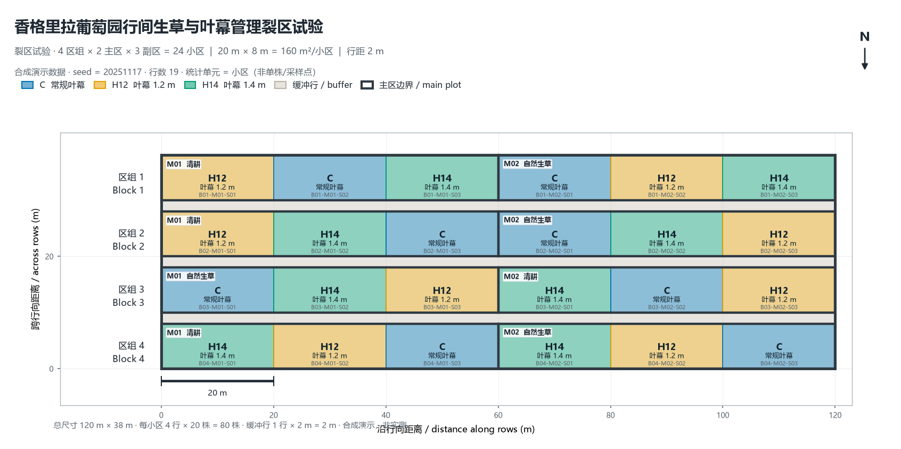

# splitplot-designer

可复现的裂区试验设计、校验与功效分析命令行工具：从 YAML 配置到随机分配、田间布局图、误差分层模型与模拟功效，一条命令链完成。

[](https://github.com/YilongXiao/splitplot-designer/actions/workflows/ci.yml)
[](LICENSE)
[](https://www.python.org)



> 上图为 `examples/vineyard_4blocks.yaml` 的真实运行输出（合成演示数据，seed 20251117，24 小区）。

## 为什么做这个

裂区试验最常见的三类错误是：主区随机化靠手抄、无法复现；把同一小区的采样点或单株当重复，主区被伪重复；分析时用完全随机模型检验主区效应，p 值偏乐观。这个工具把这三件事固定下来——随机化由显式种子驱动并可校验摘要，统计单元始终是小区，模型与功效模拟都使用正确的误差分层。它服务于田间试验方案设计阶段，而不是替代统计分析软件。

## 安装

需要 Python 3.10 或更新版本。Windows PowerShell：

```powershell
git clone https://github.com/YilongXiao/splitplot-designer.git
cd splitplot-designer
py -3.12 -m venv .venv
.\.venv\Scripts\Activate.ps1
python -m pip install -U pip
pip install -e ".[dev]"
```

若 PowerShell 阻止激活脚本，可先执行 `Set-ExecutionPolicy -Scope Process -ExecutionPolicy Bypass`。

macOS / Linux：

```bash
git clone https://github.com/YilongXiao/splitplot-designer.git
cd splitplot-designer
python3 -m venv .venv
source .venv/bin/activate
python -m pip install -U pip
pip install -e ".[dev]"
```

安装后 `splitplot` 命令可用。验证：`splitplot --version` 输出 `splitplot 0.1.0`。

## 快速开始

```bash
splitplot init -o design.yaml
splitplot validate design.yaml
splitplot design design.yaml -o build/demo
```

`init` 写出带注释的合成模板（4 区组 × 2 主区 × 3 副区，24 小区）；`validate` 输出结构校验结果；`design` 生成 `allocation.csv`、`design.json`、`field-map.png` 与 `field-map.svg`。重复写入同一非空目录时加 `--force`，只出 PNG 用 `--formats png`，换种子用 `--seed 12345`。

不改模板、直接用仓库示例：

```bash
splitplot design examples/vineyard_4blocks.yaml -o build/demo --force
splitplot power --blocks 4 --effect 0.6 --icc 0.2 --sims 300
splitplot model examples/vineyard_4blocks.yaml
splitplot methods examples/vineyard_4blocks.yaml -o build/methods.md
```

`power` 会给出主区、副区与交互的模拟功效，并在主区功效低于 80% 时搜索建议区组数（上例建议 8 个区组）。`model` 打印 statsmodels 与 R 的误差分层公式，`methods` 生成可编辑的中英文方法段草稿。

## 输入格式与输出说明

输入是一个 UTF-8 YAML 文件，只有 `experiment` 一个顶层节：

| 字段 | 类型 | 规则 |
| --- | --- | --- |
| `title` | 字符串 | 非空，写入图题与 JSON |
| `blocks` | 整数 | 完整区组数，`>= 3`；超过 10 会警告布局过高 |
| `main_plot.name` / `sub_plot.name` | 字符串 | 两个因子名必须不同 |
| `*.levels[]` | `{code, label}` 列表 | 每因子至少 2 个水平；`code` 字母开头、仅字母数字下划线连字符、最长 12 字符且因子内唯一；`label` 非空 |
| `layout.plot_length_m` | 数字 | `> 0`，须等于 `vines_per_row × vine_spacing_m`（容差 5%） |
| `layout.plot_width_m` | 数字 | `> 0`，须等于 `rows_per_plot × row_spacing_m`（容差 5%） |
| `layout.rows_per_plot` / `vines_per_row` | 整数 | `>= 1` |
| `layout.buffer_rows` | 整数 | `>= 1`，仅设在区组之间 |
| `layout.row_spacing_m` / `vine_spacing_m` | 数字 | `> 0`，单位 m |
| `sampling.points_per_plot` | 整数 | `>= 1`；`> 1` 会提示采样点不是重复 |
| `sampling.treated_as` | 枚举 | `plot_mean`（先求小区均值，推荐）或 `replicates`（伪重复风险） |
| `seed` | 整数 | `0..4294967295` |

校验错误按 `文件:行号` 输出，带中英双语说明（多数附修复提示）；有错误时退出码为 1。未知字段只警告不报错。

`design` 在输出目录写入：

| 文件 | 内容 |
| --- | --- |
| `allocation.csv` | UTF-8（带 BOM），列 `block,main_code,sub_code,plot_id,row_start,row_end,vine_start,vine_end`；行列坐标从 1 开始且含端点 |
| `design.json` | schema 1.0，含种子、全部水平、几何、采样设置、随机化过程说明、分配数组与 `allocation_digest_sha256` |
| `field-map.png` / `field-map.svg` | 田间布局图，颜色对应副区水平，粗框为主区边界，灰色带为缓冲行 |

同一配置与种子必然得到相同分配和相同 SHA-256 摘要；摘要可用作方案归档的指纹，但不是密码学签名。

## 方法与局限

模型为随机完全区组裂区设计：主区因子在区组内随机，副区因子在主区内随机，区组完整。主效应以 `MS(main) / MS(block:main)` 检验（df 为 `(a-1, (r-1)(a-1))`），副区与交互以小区残差为分母；统计单元是小区的均值。功效部分用蒙特卡洛模拟，误差分为主区层与小区层，ICC 为主区误差方差占总误差方差的比例，所有 F 检验使用对应误差层。随机化使用 Python `random.Random`（Mersenne Twister）单一流，先洗牌主区、再在每个主区内洗牌副区。

已知局限：只支持单一设计族（两因子、完整区组、无缺失小区）；不替代正式分析，`model` 只给公式草稿；功效假设 ICC 已知、误差正态独立方差齐、区组效应固定，搜索上限 12 个区组；布局是矩形示意图，不是 GIS，未考虑机械转弯半径；中文标签依赖系统 CJK 字体，缺失时回落 DejaVu Sans 可能显示方框；只输出 PNG/SVG。

完整公式、假设、单位、出处与更多局限见 [docs/methods.md](docs/methods.md)。

## 数据来源与是否合成

`examples/` 下两份配置与 `splitplot init` 模板均为**合成演示**，不是实测数据：`vineyard_4blocks.yaml`（24 小区）和 `vineyard_3blocks.yaml`（18 小区、最小合规结构）只用于演示流程，水平名称借用了葡萄园场景。图纸页脚与 CLI 输出都标注“合成演示”，JSON 的 `title` 直接取自配置。把配置替换成自己的区组数、水平与几何即可生成本地设计；实测坐标需自行按田间测量结果核对。

## 测试

```bash
ruff check .
pytest -q
```

当前 49 个测试通过，覆盖主路径、边界与错误输入：帮助与版本、模板生成、校验规则（区组、缓冲、几何、种子、重复编码、因子重名）、随机化可复现与区组完整性、输出产物、功效方向性与解析参照、模型自由度。CI 在 Ubuntu 与 Windows 上以 Python 3.11/3.12 运行 `ruff check .` 与 `pytest`。贡献流程与数据口径见 [CONTRIBUTING.md](CONTRIBUTING.md)。

## 引用

若在论文或方案中使用本工具，请引用：

```bibtex
@software{xiao_splitplot_designer_2026,
  author  = {Xiao, Yilong},
  title   = {splitplot-designer: reproducible split-plot design and power analysis},
  year    = {2026},
  version = {0.1.0},
  license = {MIT},
  url     = {https://github.com/YilongXiao/splitplot-designer}
}
```

机器可读元数据见 [CITATION.cff](CITATION.cff)。

## English summary

splitplot-designer is a small Python CLI for randomized complete block split-plot trials. It validates a YAML design, randomizes whole plots within blocks and sub plots within whole plots from an explicit seed, and writes a CSV allocation, a JSON manifest with a SHA-256 digest, and a field map. It also emits correctly stratified statsmodels and R formulas, a bilingual methods draft, and a Monte Carlo power simulation that keeps whole-plot and residual error separate. The statistical unit is always the plot; pseudo-replication from subsamples is flagged. Only one design family is supported and all bundled examples are synthetic. MIT licensed.

## License

[MIT](LICENSE) © 2026 Yilong Xiao
